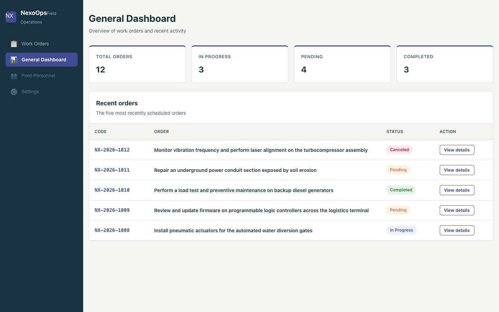
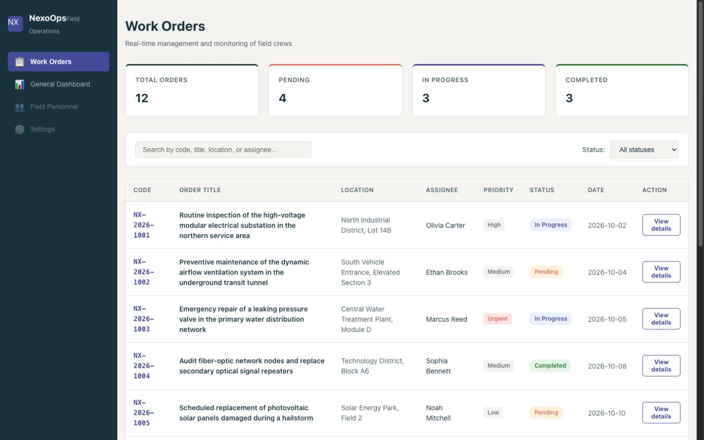
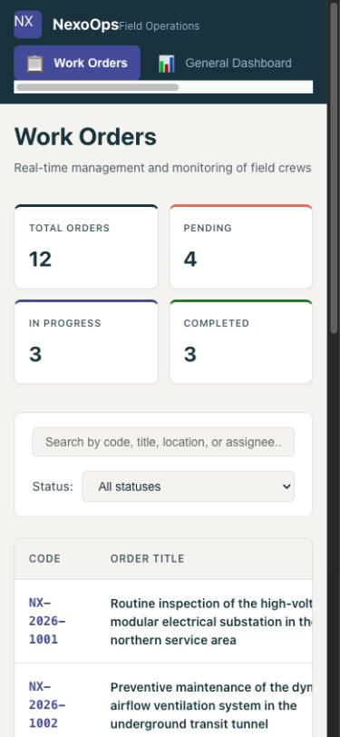

# NexoOps — Field Operations Console

A responsive operations dashboard built with React, TypeScript, and Vite. It demonstrates search and filtering over a dense work-order table, a detail panel, and layouts that remain usable on narrow screens. The 12 orders, people, and locations are fictional static data; this is a frontend portfolio project, not a connected operations service.



## Explore the interface

- **Work Orders:** Search by code, title, location, or assignee; combine search with a status filter; open a record's detail panel.
- **General Dashboard:** Review status counts and the five orders with the latest scheduled dates. Select an order to inspect its details.
- **Responsive table:** On a narrow viewport, scroll the table within its card while the rest of the page stays in place.

| Work Orders, desktop | Work Orders, mobile |
| --- | --- |
|  |  |

Screenshots show the local app at desktop and mobile widths, with no cursor overlay.

## Acceptance criteria

1. The initial Work Orders view shows 12 orders and summary counts of 4 pending, 3 in progress, and 3 completed.
2. Search is case insensitive across code, title, location, and assignee. A status filter applies at the same time. A query with no matches shows the empty state.
3. Selecting **View details** opens the matching order's code, description, status, priority, assignee, date, and location. **Close Details** dismisses the panel; switching views also clears the selection.
4. General Dashboard shows the same four summary counts and the five most recently scheduled orders, ordered by date descending.
5. At 390 px, 768 px, and 1440 px viewport widths, the document has no horizontal overflow. At narrow widths, the Work Orders table scrolls horizontally inside its card.

## Run and verify

Requires Node.js 20.19+ or 22.12+ and npm 10+.

```bash
npm ci
npm run lint
npm run build
npm run dev
```

Open the local URL printed by Vite. Check the acceptance criteria in the browser, including a search that matches an assignee, a combined search and status filter, the empty state, and the mobile table scroll.

## Code map

- `src/data/orders.ts`: Synthetic work-order fixture.
- `src/App.tsx`: View state, search, filtering, and detail selection.
- `src/components/`: Dashboard, table, navigation, badges, and detail panel.
- `src/App.css`: Responsive layout and table scroll containment.
